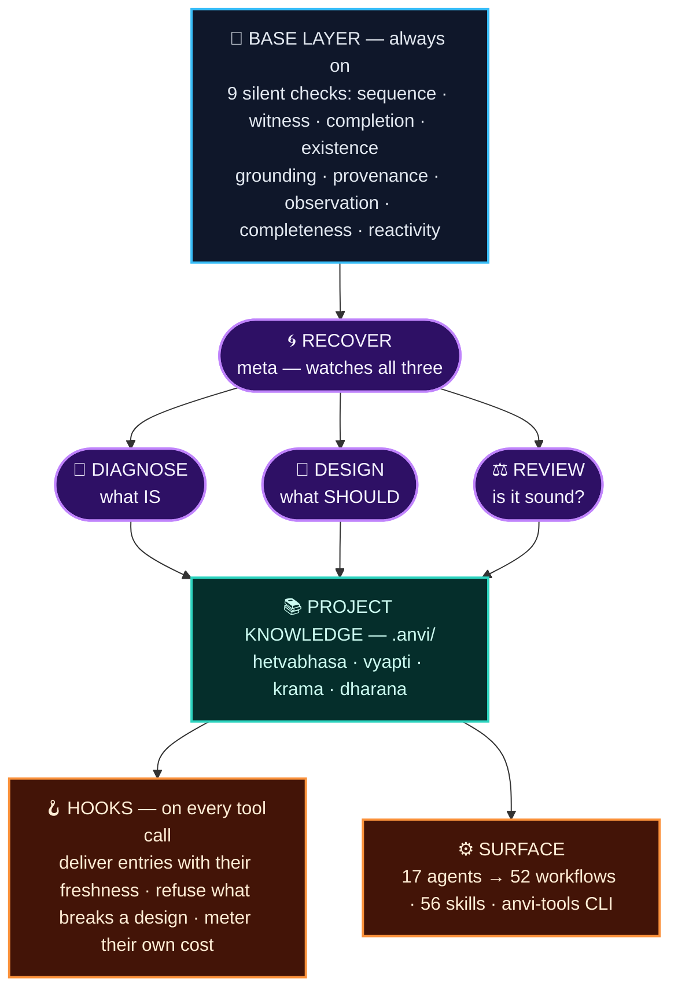
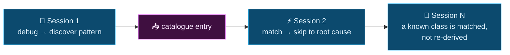
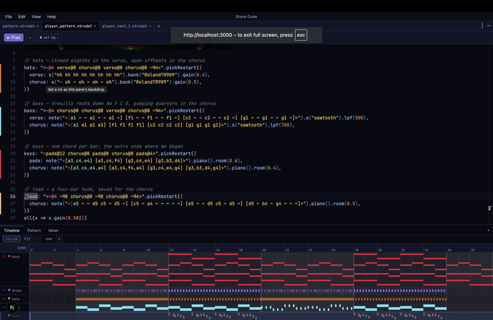
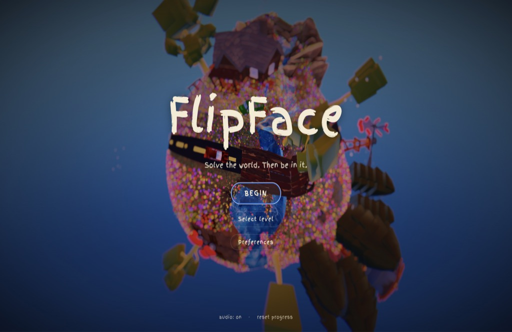
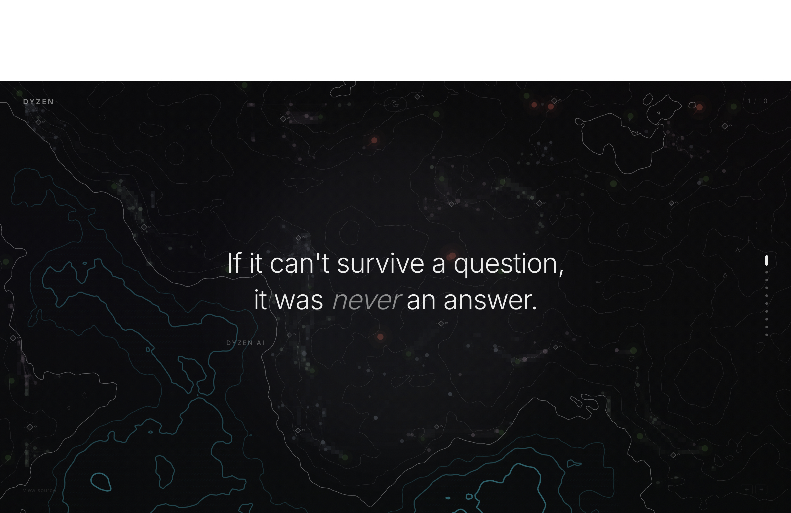
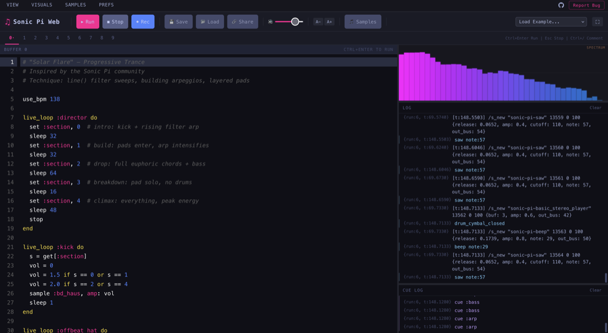
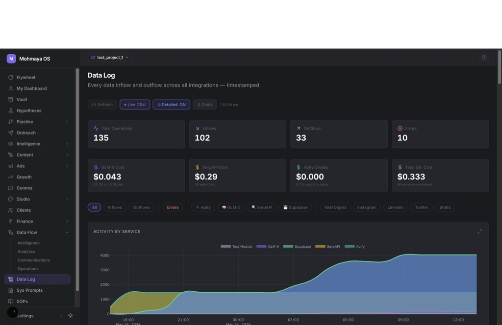

<div align="center">

# 🧠 Ānvīkṣikī · `anvi`

### A cognitive operating system for software engineering

**Plan · execute · verify · ship — with the discipline of _how to think_ built into every agent.**

<br>


</div>

---

> [!TIP]
> **Catalogues make the black box transparent.** Reasoning becomes _deductive_ — from stated principles to conclusions, confirmed by observation — instead of _empirical_ — probing a black box through failure. Anvi is fully standalone: one `./install.sh` and you're running.

## 🎯 Latest release: Armed (`2026.10.0`)

**The framework starts refusing.** Until now, Anvi advised: it put the right notes in front of an agent and hoped they were read. From Armed on, it can also refuse. You declare a project's design (its components, and which may import which), and an edit that breaks it is refused before it lands. What decides a refusal can be locked per package in a root-owned directory, so it changes only with your password and never because an agent edited it.

**Proven on a real project.** stave was armed for a two-week trial. The guard refused 2 edits out of 2 chances, and both refusals were ruled right. Then the list of allowed rule breaks shrank for the first time, from 18 to 17. Moving a misplaced helper to its rightful owner exposed a test that had been quietly forcing the architecture out of shape. The test was fixed instead of the design being bent.

- What changed: [`CHANGELOG.md` → 2026.10.0](CHANGELOG.md)
- The full story, with proofs: [issue #532](https://github.com/MrityunjayBhardwaj/anvi/issues/532)
- No migration needed. Run `./install.sh --sync`, or `/anvi:update`. Nothing is armed until you arm a package.
- **Next:** *Architecture* (`2026.11.0`). Know where every job belongs, and make the part a machine can enforce binding ([#698](https://github.com/MrityunjayBhardwaj/anvi/issues/698)).

## ✨ What Anvi does

| Capability | How Anvi does it |
|---|------|
| 🔬 **Debugging** | Cognitive chain: gather → classify → scan boundaries → compress → prove |
| 🧭 **Plans** | Ownership mapping, lifecycle sequencing, pre-mortem analysis |
| 📐 **Plan checks** | 13 dimensions — 7 standard + 6 cognitive (vyapti, krama, hetvabhasa, testability, ownership, UX) |
| 🩺 **On failure** | Diagnose _which cognitive check was missed_ — not a blind retry |
| 📚 **Memory** | Growing catalogues: error patterns, invariants, lifecycles |

## 🗺️ Architecture

<div align="center">



</div>

The four lenses **overlap — they don't switch.** `RECOVER` is the parent that watches the other three fire.

Instructions can be forgotten when a context is compressed; hooks can't. They read the catalogues from disk at the moment an edit touches a boundary, and the structure guard can refuse a tool call outright.

> [!NOTE]
> Full structural map in [`SYSTEM_ARCHITECTURE.md`](SYSTEM_ARCHITECTURE.md). Every hook, what it may do, and where it is registered: [`ENFORCE.md`](ENFORCE.md).

## 🔁 How thinking compounds

Every diagnosis feeds the catalogues, so the same class of bug is never re-derived from scratch:



An entry is only as good as the code it still matches. Every entry delivered to a session comes with its freshness: **verified** (re-checked since its code last changed), **drifted** (a file it cites has changed since), or **never confirmed**. Nothing is withheld; the state is stated next to it. Each session must end with fewer drifted entries than it started with, and `/anvi:currency` re-validates them.

## 🚀 Installation

```bash
git clone https://github.com/MrityunjayBhardwaj/anvi.git
cd anvi
./install.sh
```

The installer asks which integrations to install: **Claude Code** (deploys the framework to `~/.claude/anvi/`, **17 agents** to `~/.claude/agents/`, **56 skills** to `~/.claude/skills/`, and registers the hooks), **Copilot** (the [compatibility layer](copilot-compat/README.md) for VS Code Copilot Chat), or both. `--only=claude`, `--only=copilot` or `--only=all` skips the question. The shared framework always installs, and the installer can create your project catalogues (`.anvi/`).

Already installed? Run `/anvi:update`, which brings the framework, the hook registrations and every project's catalogues up to date in one pass.

<details>
<summary><b>⚙️ Install modes</b></summary>

<br>

| Command | What it does |
|---------|-------------|
| `./install.sh` | Interactive — asks which integrations, and prompts before overwriting an existing install |
| `./install.sh --only=<claude,copilot,all>` | Install only the named integrations, without asking |
| `./install.sh --dev` | **Dev mode** — symlinks repo → live. Edits to the repo are immediately live. |
| `./install.sh --no-dev` | Break symlink, switch back to standalone copy mode |
| `./install.sh --sync` | Silent one-way copy from repo → live (no prompts). On a dev install it copies nothing — it links hooks, skills and agents added since and registers the hooks. |
| `./install.sh --migrate [dir ...]` | One-pass upgrade of an existing clone — framework sync + retired-hook prune + per-project catalogue migration for each `dir`. Idempotent. Usually driven by `/anvi:update`. |
| `./install.sh --version-list` | List all releases (version + date + whether it needs a migration + summary), marking installed and latest |
| `./install.sh --version <v> [--migrate]` | Install/upgrade to a specific version. Upgrade-only (refuses to go below installed). Older tagged releases come from `git archive`; your clone is never checked out. |
| `./install.sh --check` | Show repo version vs installed version, change nothing. On a dev install it also names any hook not yet linked. |

**For contributors:** use `--dev` — the repo _is_ the live installation. After pulling a change that adds a hook, skill or agent, run `--sync` to link it. Run the installer from the clone the install is linked to: from any other tree (a worktree, a second clone) it refuses rather than write through the links.

### Working in a git worktree

A worktree gets your project's Anvi knowledge **only through links you add**. It has its own
root, so nothing resolves back to the main checkout on its own. Link the catalogues and the
Ground Truth docs to where the main checkout's resolve, and keep both out of `git status`:

```bash
ln -s ~/.anvideck/projects/<project>/.anvi <worktree>/.anvi
ln -s ~/.anvideck/projects/<project>/ref   <worktree>/ref
printf '%s\n' /.anvi /ref >> "$(git -C <worktree> rev-parse --path-format=absolute --git-common-dir)/info/exclude"
```

Use `--path-format=absolute`: from inside a worktree, a relative `--git-common-dir` names
the worktree's `.git` file, not the shared directory. If you skip the links, the session
start and the catalogue injector say which ones are missing, once per session, with these
commands filled in.

### Versions

Releases are numbered **`YYYY.0M.PATCH`** — `2026.10.0`, then `2026.10.1` for a fix in
the same month. The number tells you _when_ a release was cut, which is the useful fact
when the install path is `git clone` and you want to know how far behind you are.

Whether an upgrade needs you to do anything is a separate question, so it gets a separate
answer: a release that requires one carries a **MIGRATION REQUIRED** line in the
changelog, and `--version-list` shows it in the `MIGRATE` column.

```
  VERSION     RELEASED     MIGRATE  SUMMARY
  v2026.10.0  2026-10-30            Armed: the framework starts refusing. An edit tha...  ◀ installed
  v2026.08.0  2026-08-01   yes      Two changes require an existing install to migrat...
  v2.0.0      2026-07-23   yes      Major release. Since 1.1.0 the framework grew a c...
```

A blank means the release does not state one — not that it is safe to skip checking.
Releases before `2026.08.0` used semantic versioning and keep their original numbers, so
`--version 2.0.0` still resolves.

The month is always zero-padded. Versions are matched as exact strings, so `2026.8.0` is
a different version from `2026.08.0` and will be reported as unknown.

</details>

## 🛡️ Arming a package — the structure guard

The guard refuses an edit that adds an import your design doesn't allow. It does nothing until you arm a package, and it only ever refuses what an edit **adds**: imports that already exist are recorded in a baseline and tolerated, so a real codebase can adopt it without first repairing everything it carries.

| Step | Command (scripts live in `~/.claude/anvi/scripts/`) |
|------|---------|
| 1. **Declare the design** | Write a `design.json`: the `components` (each a set of `dirs` and `files`) and the `allowed` imports between them as `[from, to]` pairs. Format: [`ENFORCE.md` → Structure Guard](ENFORCE.md#structure-guard--the-edge-that-erodes-a-design-refused-only-when-it-is-new). |
| 2. **Measure and take a baseline** | `node structure-guard.js --design design.json --package <dir> --write-baseline baseline.json` |
| 3. **Replay real sessions first** | `node structure-replay.js --repo <git dir> --package <path> --design design.json --transcripts <dir> --since <commit>` lists what the guard *would* have refused, for you to rule on |
| 4. **Arm** | `node structure-guard.js --design design.json --graph <depcruise.json> --package <dir> --arm --baseline baseline.json` registers the package, but only if two independent import graphs agree: the hook's own and [dependency-cruiser](https://github.com/sverweij/dependency-cruiser)'s (`depcruise --output-type json <src> > depcruise.json`) |
| 5. **Read the trial** | `node structure-refusals.js --package <dir> --since <time>` counts every refusal and every chance to refuse, so an untested window can't read as a passed one |
| 6. **Lock it** (optional) | `node structure-lock.js promote --package <dir>` shows every field that would change and prints a `sudo` command pinned to exactly what you reviewed (or, until the lock's own node and installed copy exist, what is missing). Once locked, what decides a refusal lives in a root-owned directory and changes only with your password. |

A refusal offers two remedies: change the code, or change the design, which is your decision. `structure-guard.js --proposed <design.json>` shows what a design change would reclassify, in both directions, before you make it. A merge through Claude Code (`gh pr merge`) is judged too, so imports written through the shell are caught at merge.

**Known limits:** a merge on the GitHub web page runs no hook, and the code that applies a locked decision still runs from your own install ([#681](https://github.com/MrityunjayBhardwaj/anvi/issues/681)).

## 🧩 Commands

The everyday loop:

| Command | Description |
|---------|-------------|
| 🌱 `/anvi:new-project` | Initialize a project with deep context gathering |
| 💬 `/anvi:discuss-phase` | Gather context through adaptive questioning |
| 🧭 `/anvi:plan-phase` | Plan with the design lens (ownership, lifecycle, pre-mortem) |
| 🔨 `/anvi:execute-phase` | Execute with cognitive gates per task |
| 🔬 `/anvi:debug` | Cognitive-OS-native debugging |
| ✅ `/anvi:verify-work` | Verify with the review lens |

<details>
<summary><b>📖 Full command reference</b> — cognitive tools, quick execution, navigation</summary>

<br>

**🧠 Cognitive tools**

| Command | Description |
|---------|-------------|
| `/anvi:rq` | Surface the right questions for the current context |
| `/anvi:lens` | Map all lenses — active, sister, opposing, parent |
| `/anvi:orient` | Where am I? What's known / unknown / assumed? |
| `/anvi:explore` | A friction point — something that should exist and doesn't. The friction becomes the spec |
| `/anvi:sess-wrap` | Harvest the session's lessons into the catalogues |
| `/anvi:update-board` | Put an issue on the project board and set its Status, ids derived not pasted |
| `/anvi:currency` | Which catalogue entries have drifted from the code they cite |
| `/anvi:currency --fleet` | Snapshot catalogue health across the store — what moved since last time |
| `/anvi:ground` | Establish three-layer grounding (catalogues → Ground Truth → source) |

**⚡ Quick execution**

| Command | Description |
|---------|-------------|
| `/anvi:do` | Route freeform text to the right command |
| `/anvi:quick` | Small task with guarantees |
| `/anvi:fast` | Trivial inline edit |
| `/anvi:autonomous` | Run all remaining phases |

**🧭 Navigation**

| Command | Description |
|---------|-------------|
| `/anvi:progress` | Status with cognitive metrics |
| `/anvi:next` | Auto-advance to the next step |
| `/anvi:resume-work` | Resume with cognitive state restored |
| `/anvi:pause-work` | Save state with a tattva checkpoint |

**🔧 Keeping the install healthy**

| Command | Description |
|---------|-------------|
| `/anvi:update` | Update to the latest (or a named) version: framework, hook registrations and every project's catalogues, in one idempotent pass |
| `/anvi:settings` | Workflow toggles, model profile, and how long Claude Code keeps sessions |
| `/anvi:health` | Diagnose the planning directory and optionally repair it |
| `node ~/.claude/anvi/scripts/meter-report.js` | What each hook costs: runs, bytes injected, milliseconds |

Run `/anvi:help` for the complete list.

</details>

## 🧠 The Cognitive OS

<details open>
<summary><b>Always-on base layer</b> — 9 checks running silently on every action and every fix</summary>

<br>

- 🕐 **Sequence** — am I assuming execution order?
- 👁️ **Witness** — am I discriminating or reacting?
- 🎯 **Completion** — is this good enough to ship?
- 🧱 **Existence** — do I understand why this code exists?
- ⚓ **Grounding** — is my claim about this system grounded in source code, or inferred?
- 🧭 **Provenance** — does this information belong to the project I'm working in?
- 🔬 **Observation** — did I run it, or just read it?
- 🧾 **Completeness** — can I state the full argument? (behavioral changes only)
- ⚡ **Reactivity** — is this fix driven by insight or urgency?

</details>

**Four lenses** (they overlap, they don't switch):

| Lens | Chain | Core question |
|------|-------|---------------|
| 🔎 **diagnose** | gather → classify → scan → compress → prove → fix → ship | What IS the problem? |
| 🧩 **design** | dharana → vyapti → krama → ownership → hickey → ousterhout → hetvabhasa → chesterton → prototype | Who owns this? What's the lifecycle? |
| ⚖️ **review** | chesterton → beck → suckless → lokayata → hetvabhasa → hyrum → vyapti | Is my reasoning sound? |
| 🌀 **recover** | stop → compress → revert → receive → re-enter | Am I reacting instead of thinking? |

**Growing project knowledge** — per-project `.anvi/` catalogues:

- `hetvabhasa.md` — error patterns (only from bugs diagnosed in one pass)
- `vyapti.md` — validated invariants (confirmed by direct observation)
- `krama.md` — lifecycle sequences (verified execution order)
- `dharana.md` — where to focus: this project's boundaries, how each one fails silently, and what to observe there (derived from the other three)

Each entry cites the code it describes. The catalogues live in a central store (`~/.anvideck/projects/<project>/.anvi`), and a project's `.anvi` is a link to it, so there is one copy however many checkouts you have ([`STORAGE.md`](STORAGE.md)).

<details>
<summary><b>🧵 Thinking trace</b> (Ctrl+O) — labeled reasoning phases</summary>

<br>

```
[GATHER]  OBSERVED: setTimeout defers setup — seen via code read
[CLASSIFY] → B (timing). Signal: async ordering
[SCAN]     Boundary: mount ↔ RenderEngine. Before: schedules setTimeout — OBSERVED
[COMPRESS] resize fires before async setup creates canvas → no-op
[PROVE]    Running node bug1... → CONFIRMED
[SHIP]     1 pass. 0 workarounds.
```

</details>

> [!IMPORTANT]
> **Translation layer:** all internal reasoning uses Sanskrit terms for precision; all output uses plain English. The user never sees the machinery — just better results.

## 👁️ Watch it think — AnviDeck

Anvi accumulates state: catalogues grow, invariants multiply, every session leaves a trace. State that accumulates unobserved rots. **[AnviDeck](https://github.com/MrityunjayBhardwaj/AnviDeck)** is the companion observability deck — a zero-config, offline-first dashboard that reads `~/.claude/` and shows the framework operating live, across every project and session.

<div align="center">

</div>

**Command Center · Live Trace · System Lens · Cross-Project · Routing · Project Deep Dive** — six views over the framework's cognition. Filesystem + `gh` CLI only; no database, no telemetry.

## 🌍 In the Wild

Projects built with the anvi cognitive OS:

<table>
<tr>
<td align="center" width="33%"><br><b>Stave</b><br><sub>Music Studio · the first armed project</sub></td>
<td align="center" width="33%"><br><b>FlipFace</b><br><sub>Game</sub></td>
<td align="center" width="33%"><br><b>DyzenAI</b><br><sub>Website</sub></td>
</tr>
<tr>
<td align="center"><br><b>SonicWeb</b><br><sub>Music Lang Editor</sub></td>
<td align="center"><br><b>MohMayaOS</b><br><sub>AIOS</sub></td>
<td align="center"><sub>your project?<br><a href="https://github.com/MrityunjayBhardwaj/anvi/issues/new">add it →</a></sub></td>
</tr>
</table>

## 🛑 When NOT to use this

The cognitive OS adds overhead. Skip it for:

- **Trivial changes** — renames, imports, formatting
- **Well-understood patterns** — the base layer is enough

It earns its weight on **novel integrations, framework boundaries, architectural decisions, and any problem where the first fix didn't work.**

---

<div align="center">

**⚖️ [GPL-3.0](LICENSE)**

<sub>🙏 Anvi is built on top of <a href="https://github.com/get-shit-done"><b>GSD</b></a> — go check it out.</sub>

<sub>Also runs from VS Code Copilot Chat via the <a href="copilot-compat/README.md"><b>Copilot compatibility layer</b></a>.</sub>

</div>
